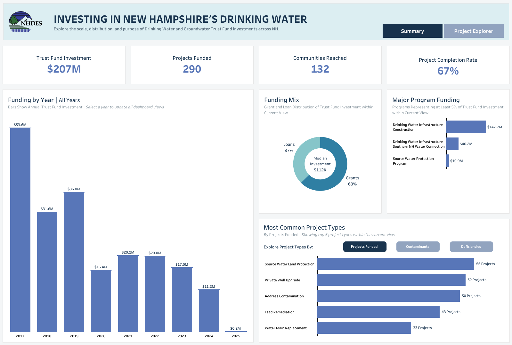
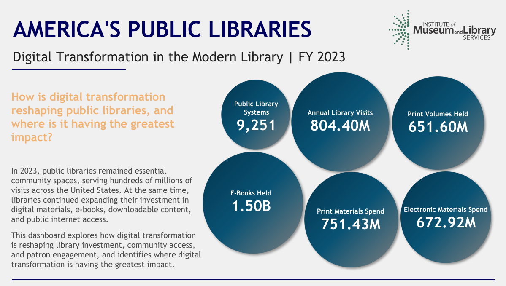
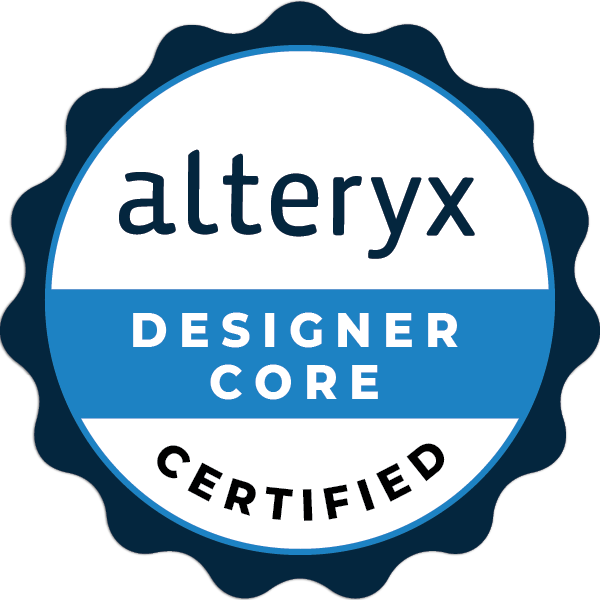
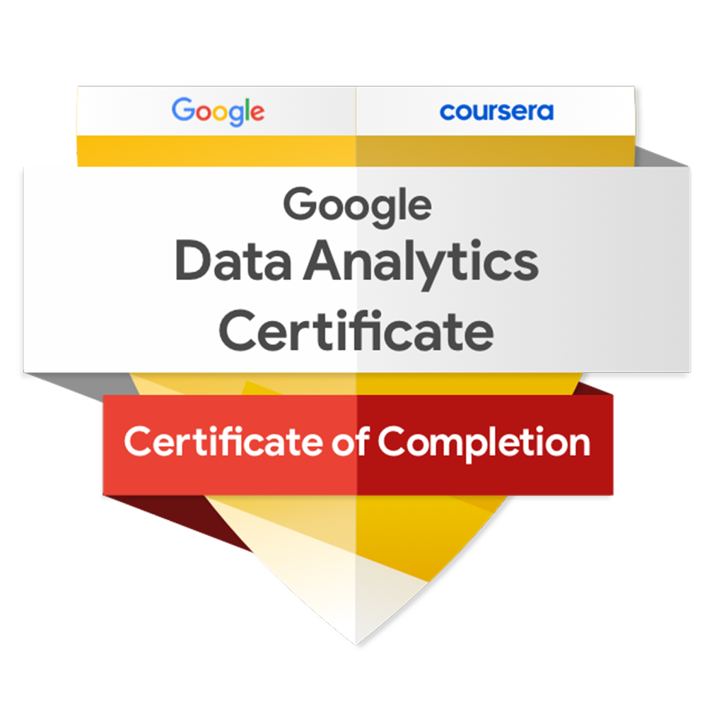
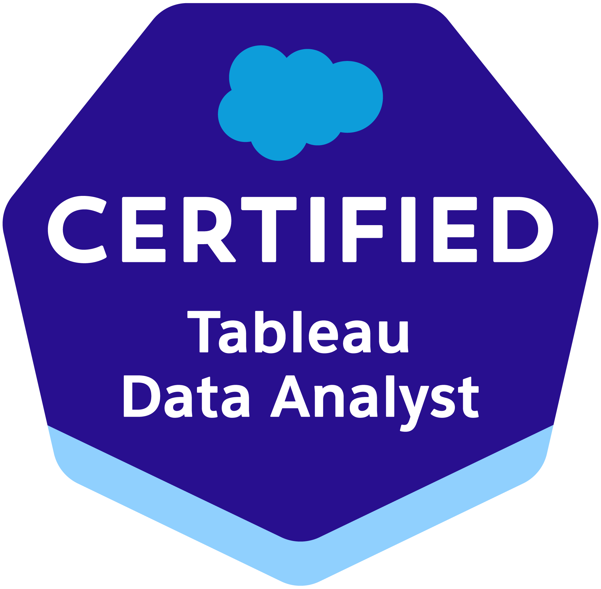

# Welcome to My GitHub! 👋

### I'm Marcus Rocco
**Data Analytics Consultant @ The Information Lab**

## About Me

I build **business intelligence solutions** that transform complex data into clear, actionable insights that support better decision-making.

As a **Data Analytics Consultant at The Information Lab**, I work with clients across the **full analytics lifecycle**, from defining project scope and translating ambiguous business problems into clear requirements to preparing data, developing visualizations, and communicating insights to stakeholders.

During my first few months, I’ve worked with **five clients**, serving as an analytics consultant across agriculture, food manufacturing, insurance & financial services, and software & technology, while also acting as **project manager** for a higher education client.

I recently earned an **M.S. in Business Analytics & Artificial Intelligence** from Stevens Institute of Technology, where I focused on data analytics, business intelligence, and applied AI.

My industry capstone project was **featured by the Stevens School of Business**. As project lead, I guided a **five-person team** in developing an **AI-powered product recommendation system** for luxury fashion retailer The Webster. Within a 14-week timeline, we used Python to clean and standardize a dataset of **approximately 27,500 products**, curating it into a balanced, model-ready selection of **roughly 1,100 items**. From this foundation, we developed a **multifactor ranking model** and a **GPT-based AI stylist** to deliver personalized recommendations aligned with each shopper’s preferences and The Webster’s brand identity.

Before graduate school, I earned a **B.S. in Management Information Systems** from Clemson University. I also spent nearly two years as a Student IT Support Center Consultant, where I strengthened my ability to troubleshoot technical challenges and communicate solutions to non-technical audiences.

## Data Visualization Projects

Explore some of my interactive dashboards and data visualization projects built using Tableau.

<table>
  <tr>
    <td width="50%" align="center" valign="top">
      <strong>NHDES Drinking Water and Groundwater Trust Fund Dashboard</strong>
        
      
        
      <a href="https://public.tableau.com/views/NHDESDrinkingWaterandGroundwaterTrustFundDashboard/SummaryView?:language=en-US&amp;:display_count=n&amp;:origin=viz_share_link">
        📊 View Interactive Dashboard
      </a>
    </td>
    <td width="50%" align="center" valign="top">
      <strong>Digital Transformation in America's Libraries</strong>
        
      
        
      <a href="https://public.tableau.com/views/InformationLabFinalDashboard-DigitalTransformationinAmericasLibraries/FinalDashboard?:language=en-US&amp;:sid=&amp;:redirect=auth&amp;:display_count=n&amp;:origin=viz_share_link">
        📊 View Interactive Dashboard
      </a>
    </td>
  </tr>
</table>

## Certifications

| Alteryx Designer Core Certified | Google Data Analytics Professional Certificate | Salesforce Certified Tableau Data Analyst |
|:-:|:-:|:-:|
|  |  |  |

## Explore More of My Work

- 🌐 **Portfolio:** [https://marcusjrocco.github.io/Marcus-Rocco/](https://marcusjrocco.github.io/Marcus-Rocco/)
- 📊 **Tableau Public:** [https://public.tableau.com/app/profile/marcus.rocco/vizzes](https://public.tableau.com/app/profile/marcus.rocco/vizzes)
- 📝 **Blog (The Data School):** [https://www.thedataschool.com/blog/marcus-rocco/](https://www.thedataschool.com/blog/marcus-rocco/)
- 🎓 **Featured by Stevens:** [https://www.stevens.edu/news/behind-the-seams](https://www.stevens.edu/news/behind-the-seams)
